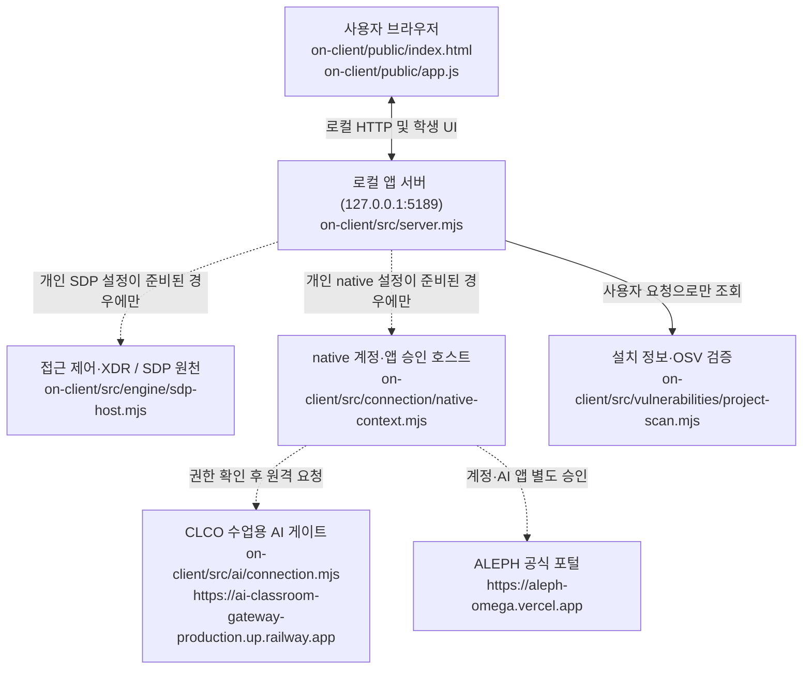

# HORSE 학생 실행 설명서 및 구성도 — 21단계

> **상태(2026-10-26):** 이 문서는 `on-client` 공식 스타터 및 학생 구현 코드를 GitHub에서 **읽고 대조해 작성**한 사용 안내다. 작성 중 Windows PC에서 실행하거나 실제 ALEPH 계정·SDP·AI·OSV 요청을 성공시킨 기록은 없다. 아래 실행 명령은 저장소의 `tools/start-alekov.ps1`, `package.json`, 기존 제공 실행 안내에 **존재하는 명령**이며, 이 문서 작성자의 새 PC 재현 실적이 아니다. 오류/미확인을 성공으로 바꾸지 않는다.

## 1. 용도, 범위, 이름

- **HORSE**는 학생이 붙인 보안 Agent 이름이다. 제공 스타터의 기본 이름은 **케셰브(KESHEV)**이며, 화면 제목이 HORSE로 자동 변경된다고 주장하지 않는다.
- 목적: 직원 자신의 로그인·기기·세션 상태, 업무 앱 접근 판정, 관련 보안 기록과 근거, 참고용 AI 설명, 조치 진행 상태, 설치 패키지/OSV 조회 상태를 구별해 표시한다. 전체 관리자 콘솔은 아니다.
- 13~20단계 학생 화면 구현은 `on-client/student/extension.mjs`에 있으며, 21단계는 **학생 문서만 추가**한다.
- 이 저장소에는 별도 BYTE BACK 1~12단계 자료실/API 프로젝트도 있다. 루트 `README.md` 및 `api/`는 해당 서비스의 이력을 포함한다. 아래 `on-client/` 실행 명령은 **공식 KESHEV 스타터 앱**용이다. 앞서 별도로 전달한 HORSE V10 ZIP의 `HORSE_START.cmd`와 동일한 실행 경로·운영 연결을 뜻하지 않는다.
- 코드·모의 데이터 검사, 앱 HTTP 서버 시작, 운영 SDP 로그인 성공, ALEPH AI 승인, 유료 설명 호출, 실제 조치 집행 및 공식 과제 합격은 **서로 다른 확인 항목**이다.

## 2. 준비물과 버전

| 항목 | 저장소 원문에서 확인한 내용 | 실제 PC에서 확인 |
| --- | --- | --- |
| 운영체제·터미널 | Windows PowerShell, 실제 디렉터리의 `on-client`에서 실행하도록 설계 | Windows 직접 실행 미확인 |
| Node.js | `on-client/package.json`의 `engines.node`는 `24.19.0`; 제공 안내는 Node.js 22~24를 지원한다고 설명 | 설치된 PC 버전 미확인 |
| 학생 앱 패키지 | `on-client/package.json`: `alekov-client-starter` 0.2.11, `type: module` | 버전 문자열 소스 확인 |
| 의존성 | `on-client/package.json`에는 외부 `dependencies`가 없음. **루트** `package-lock.json`과 혼동하지 않는다 | on-client 외부 설치 필요 없음(구성상) |
| 브라우저 | Windows PC의 브라우저에서 loopback 접속 | 브라우저 실검증 미확인 |
| 공개 포털 | `https://aleph-omega.vercel.app` (`src/ai/connection.mjs`의 상수) | 로그인·승인 미확인 |
| CLCO 게이트 | `https://ai-classroom-gateway-production.up.railway.app` (동일 파일의 상수) | 실제 AI 모델 권한/응답 미확인 |

비밀 없는 런타임 견본은 `on-client/.env.example`에 있다. 이 견본 자체가 개인 연결 승인이나 운영 설정은 아니다. `.env`, 토큰, 키, 인증서, 기기 식별 비밀과 운영자의 개인 설정 파일은 Git/화면/채팅/제출 원문에 넣지 않는다. 학생이 임의로 서비스 자격이나 OSV 허용 목록을 구성하지 않는다.

### 실제 경로 및 파일

```text
<Git 저장소 최상위>/
  README.md                         # 기존 BYTE BACK 프로젝트 문서: 수정하지 않음
  package-lock.json                 # 루트 패키지 잠금 파일; on-client 것이라고 단정 금지
  on-client/
    README.md                       # 제공 스타터 소개·실행 방법: 수정하지 않음
    package.json                    # Node 실행 스크립트·버전 계약
    .env.example                    # 비밀 없는 예제 설정
    tools/start-alekov.ps1          # 제공 Windows 실행기
    public/index.html               # 제공 메뉴·버튼·학생 표시 칸
    public/app.js                   # 제공 조회·요청·취소·늦은 응답 차단
    src/server.mjs                  # loopback 앱 서버/API
    src/engine.mjs                  # 연결 없음/예제 엔진
    src/engine/sdp-host.mjs         # 운영자가 설정한 경우 SDP 호스트 연결
    src/connection/native-context.mjs # 운영자가 설정한 경우 native 계정·AI 연결
    src/ai/connection.mjs           # ALEPH/CLCO 연결 상수·도우미
    student/engine-adapter.mjs      # 제공 서버 기능을 본인 범위로 위임하는 어댑터
    student/extension.mjs           # 학생이 13~20단계에 구현한 화면 함수
    docs/STUDENT_LAUNCH_GUIDE.md   # 제공 실행 안내
    docs/CONNECTION_TROUBLESHOOT.md # 제공 오류 안내
    docs/AI_SETUP_GUIDE.md         # 제공 AI 절차
    docs/STUDENT_RUNBOOK.md        # 이 학생 문서 (21단계)
```

상기 파일명은 GitHub 현재 작업 브랜치에서 대조했다. 이 문서에 있는 경로 문자열은 예시 루트 `<Git 저장소 최상위>`를 제외하고 저장소 상대 경로다.

## 3. PowerShell 실행·종료·재실행

**절대 기존 작업 폴더를 삭제·초기화·덮어쓰지 않는다.** PowerShell을 여는 위치는 Git 저장소 최상위가 아니라 `on-client` 폴더다. 탐색기에서 해당 폴더를 연 뒤 주소창에 `powershell`을 입력해 새 PowerShell 창을 연다. 저장소가 실제로 체크아웃돼 있어야 하며 GitHub 웹페이지에서는 이 명령으로 앱을 켤 수 없다.

실행 전 환경 확인(실행을 위한 명령이며 **본 문서 작성 중 실행한 결과는 없음**):

```powershell
node --version
Get-Location
Test-Path .\package.json
Test-Path .\tools\start-alekov.ps1
```

위 위치가 `on-client`임을 확인한 다음, 제공 `tools/start-alekov.ps1`의 실제 사용 명령:

```powershell
powershell -NoProfile -ExecutionPolicy Bypass -File .\tools\start-alekov.ps1
```

- 기본 요청 주소: `http://127.0.0.1:5189/`.
- 제공 실행 안내에 적힌 정상 시작 신호: **“케셰브가 켜졌습니다. 브라우저에서 http://127.0.0.1:5189/ 을 여세요.”**, **“서버가 응답한 것만 확인했습니다. AI 연결 상태는 화면에서 따로 확인해 주세요.”**. 문구는 실행 버전에 따라 달라질 수 있다.
- 화면에서 **「보호 현황」·「업무 앱」·「보안 기록」** 메뉴 및 학생 표시 칸을 확인한다. **HTTP 서버 응답만으로 SDP/ALEPH 인증 성공으로 기록하지 않는다.**
- 기존 프로그램이 5189 포트를 쓰고 있다면 종료시키지 말고 제공 실행기의 다른 포트 옵션을 사용한다:

```powershell
powershell -NoProfile -ExecutionPolicy Bypass -File .\tools\start-alekov.ps1 -Port 5190
```

  이 경우 브라우저 주소는 `http://127.0.0.1:5190/`로 바뀐다.
- **종료:** 실행한 PowerShell에서 `Ctrl+C`. `-Background`를 사용했다면 실행기가 표시한 node 프로세스 번호로 작업 관리자에서 종료한다.
- **재실행:** 같은 `on-client` 폴더에서 위 실행 명령을 다시 호출한다.
- 학생 코드 **구문 검사만** 가능한 기존 명령(연결·브라우저 테스트의 증거가 아님):

```powershell
npm run check
```

- 데모 전용 모드 `npm run demo`는 예제 자료 표시이며 실계정·SDP·AI 연동을 증명하지 않는다. 별도 `npm ci`를 `on-client`의 필수 실행 단계로 추가하지 않는다.

### 담당자가 제공한 설정이 있을 때만

제공 실행기의 `-NativeHostConfig`(계정·AI 앱 승인)와 `-SdpHostConfig`(본인·업무 앱·기록) 옵션은 서로 다른 개인 파일 경로를 받는다. **학생이 파일을 생성하거나 키를 작성하는 절차는 이 문서에 없다.** 운영자가 실제 경로를 알려 준 경우 `docs/CONNECTION_TROUBLESHOOT.md`와 `docs/AI_SETUP_GUIDE.md`의 옵션 계약을 따르고, 파일은 프로젝트·Git 바깥에 둔다. 설정이 두 개 있다는 사실만으로 두 서비스 계정이 동일한 학생이라는 증명도 아니다. 설정·권한이 없으면 기본 미연결 상태가 정상적으로 표시될 수 있다.

## 4. 현재 코드에 맞는 시스템 구성도



문자 구성도(그림 없이도 읽을 수 있게 동일 의미):

```text
브라우저 [public/index.html + public/app.js]
     ↕ HTTP 127.0.0.1:5189 (포트를 바꾼 경우 해당 포트)
앱 서버 [src/server.mjs] → 학생 화면 [student/extension.mjs]
     ├─ (기본 미연결 / 승인 설정 있을 때만) SDP·접근제어·XDR [src/engine/sdp-host.mjs]
     ├─ (계정 및 AI 앱 별도 승인) native 호스트 [src/connection/native-context.mjs]
     │      ├─ CLCO AI 게이트 [src/ai/connection.mjs]
     │      └─ ALEPH 포털 [https://aleph-omega.vercel.app]
     └─ (조회 대상 및 공개 패키지 승인 시) 설치 패키지 검증·OSV [src/vulnerabilities/project-scan.mjs]
```

화살표 점선은 **구현된 선택적 연결 경로**일 뿐 현재 사용자의 운영 연결 성공을 뜻하지 않는다. 기본 `student/engine-adapter.mjs`는 실제 호스트가 제공되지 않으면 disconnected 상태이고, 실제 운영 사건/대상 접근 권한을 자동 발급하지 않는다. 브라우저와 학생 함수는 운영 토큰이나 개인키를 받지 않는다.

## 5. 제공 영역과 HORSE 학생 구현 경계

| 함수/부분 | 경로 | 역할 및 책임 |
| --- | --- | --- |
| 제공 서버·브라우저 | `src/server.mjs`, `public/app.js`, `public/index.html` | GET/POST API, 요청·취소·세대별 늦은 응답 차단, 학생 표시 칸 연결, 신원/데이터 계약 검사 |
| 원천 연결 호스트 | `src/engine/sdp-host.mjs`, `src/connection/native-context.mjs` | SDP 본인 범위·native 승인·민감 정보 보호; 운영자 설정이 필요 |
| 취약점 스캐너 | `src/vulnerabilities/project-scan.mjs`, `public/vulnerabilities-view.mjs` | 잠금 파일·설치 메타데이터 검증, 승인된 공개 패키지만 OSV 조회, 결과 정규화 |
| 13단계 `renderIdentity` | `student/extension.mjs` | 내 사용자·기기·세션 상태와 로딩·실패 구분 |
| 14단계 `renderDecision` | 동일 | 선택 앱의 allow/deny/challenge/unknown 및 요청 상태 |
| 15단계 `renderEvents` | 동일 | 사건의 시간·근거·규칙·상태를 선택·표시 |
| 16단계 `renderStatus` | 동일 | 연결·알림·실패 안내 |
| 17단계 `renderAiConnection` | 동일 | AI 권한·모델 연결 점검 상태; 모델 확인과 실제 AI 설명 성공을 구분 |
| 18단계 `renderExplanation` | 동일 | 사건 ID·원본 근거·규칙·unknown·참고용 AI 요약 및 제안 미실행 |
| 19단계 `renderAction` | 동일 | prepared/executing/pending/unknown/succeeded 등의 수신 상태 표시; 버튼·POST·실제 집행을 만들지 않음 |
| 20단계 `renderVulnerabilities` | 동일 | 잠금 파일/설치 버전·OSV 상태·취약점 ID/수정 시각·부분 조회·미조회를 구별 |

21단계에서 기존 학생 함수, 제공 서버·판정 코드, 연결 설정, UI 버튼을 고치지 않는다. 수업 AI에게 코드를 작성하도록 부탁하는 것과 런타임의 AI 설명, 커밋 판정 AI는 서로 다른 역할이다.

## 6. 실제 UI 조작과 오류별 확인 순서

| 표시/상태(코드) | 의미 | 확인하고 할 일 |
| --- | --- | --- |
| 실행기에 `Node.js 가 없습니다` / `지금 Node.js 는 vXX` | Node 누락/버전 불일치 | 새 PowerShell에서 `node --version`; Node 24.19.0 기준 점검 후 직접 재실행 |
| `포트 5189 를 다른 프로그램이 쓰고 있습니다` | 주소 충돌 | 기존 프로그램 종료 없이 `-Port 5190`, 브라우저도 5190 |
| `앱 폴더가 아닙니다` / `시작 틀 폴더가 아닙니다` | 현재 경로/스타터 파일 불일치 | `on-client/package.json`, `tools/start-alekov.ps1` 존재 확인 |
| `연결 없음(disconnected)`, `ENGINE_NOT_CONNECTED` | 제공 원천 미연결 | 서버 시작만으로 연결되었다고 하지 않음; 운영자가 SDP 설정을 준비했는지 확인 |
| `NATIVE_LOGIN_NOT_MOUNTED`, `NATIVE_HOST_DISABLED` | native 호스트 설정/권한 미준비 | 운영자가 발급한 설정 유무만 확인; 민감 파일을 요청하거나 붙여 넣지 않음 |
| `ON_AI_PROVISIONING_PENDING` / 승인 대기 | AI 권한·앱 연결 미완료 | 「현재 로그인 확인」 또는 「상태 다시 확인」; 완료로 표시하지 않음 |
| `확인 불가`, `CONTRACT_MISMATCH`, `UNVERIFIED` | 응답 계약/근거 신뢰 불가 | 「도움정보 불러오기」 → 「확인했으며 복사합니다」로 비밀 없는 결과 확인. 정상 판정 금지 |
| `loading`, `CANCELLED`, `TIMEOUT` (패키지 조회) | 조회 중/취소/시간 초과 | 「패키지 조회 취소」 또는 시간 초과 후 「설치 패키지 조회」를 **직접** 누른다. 이전 목록이 최신 결과가 아님 |
| `not_configured` / `not_checked` (패키지) | 프로젝트 조회 설정 없음 / 공개 승인 대상 없음 | 학생이 경로·허용 목록을 임의로 바꾸지 않고 운영자에게 확인; 취약점 없음 아님 |
| `partial`, `unverifiable` (OSV) | 일부만 확인 / lockfile 또는 설치 정보 확인 실패 | 이미 확인된 취약점 ID는 보존하되 전체 조회 완료나 안전함으로 표현하지 않음 |
| `none_found` (OSV) | **조회한 범위에서만** 알려진 취약점이 없음 | 패키지·앱 전체가 안전하다는 의미가 아님 |
| `pending`/ACK (조치) | 서버 접수, 효과 미확인 | 성공·완료로 표시하지 않는다 |
| `unknown` (조치) | 처리 결과 불명 | 재집행하지 말고 「연동 시스템 결과만 재조회」만 고려. 현재 지원 조치가 없으면 이 경로는 비활성 |
| `succeeded` (조치) | `observation.effectApplied===true`와 현재 영수증 대조 시에만 효과 확인 | 관측 시각·대상·영수증을 확인하며 운영 실계정 테스트 없이 성공 주장 금지 |

메뉴와 버튼 이름은 `public/index.html` 및 제공 `public/app.js`와 대조한 표시 이름이다. 「조치 화면 취소」는 **서버에 이미 전달된 효과를 되돌리는 기능이 아니다.** 화면에서 시험 삼아 보안 조치를 실행하지 않는다.

## 7. 확인한 범위와 기다림(UNV)

| 항목 | 이번 문서 작성 시 확인 방식 | 결과 |
| --- | --- | --- |
| 폴더·명령·버전·기본 포트·버튼 | 현재 GitHub의 `README.md`, `package.json`, `tools/start-alekov.ps1`, `public/index.html` 소스 확인 | **코드 확인** |
| 13~20단계 화면 함수 보존 | 이전 단계 학생 구현 브랜치 코드 확인 | **코드 확인** |
| 제공 브라우저 조회 취소/늦은 결과 차단 | `public/app.js` 소스 확인 | **코드 확인** (PC 실행 미확인) |
| 새로운 Windows PowerShell에서 시작/종료/재실행 | 이번 21단계에서 실제 PC 실행 기록 없음 | **미확인(UNV)** |
| 13~20단계 실제 브라우저 결과 | 이 문서 작성 중 실기기 증거 없음 | **미확인(UNV)** |
| 계정·SDP 운영 실제 권한·직원 사건·기기 연결 | 개인 인증·운영 원천 데이터 확인 없음 | **미확인(UNV)** |
| AI 모델 점검, 유료 AI 사건 설명 | 실제 승인·유료 요청 미실행 | **미확인(UNV)** |
| 실제 조치 집행·서버 관측 효과 | 학생 현재 `supportedActions=[]`; 집행기 운영 연결 미준비 | **미확인(UNV), 시험 집행 금지** |
| 잠금 파일·설치 `node_modules` 실제 대조와 OSV | `on-client/.env.example` 기본 빈 허용 목록; 운영 설정·실제 조회 확인 없음 | **미확인(UNV)** |
| ALEPH 공식 21단계 제출 및 AI 검토 | 이 문서 작성만 수행 | **미실행** |

**주의:** 루트 `package-lock.json`에 npm 패키지와 정확한 버전이 적혀 있더라도, 그것만으로 OSV 조회 대상 프로젝트의 `node_modules`와 대조가 끝났다고 인정하지 않는다. 스캐너는 운영자가 지정한 `ON_PROJECT_DIRECTORY` 및 `ON_APPROVED_PUBLIC_PACKAGES`를 사용하고, 비어 있을 때는 `not_configured`/ `not_checked`가 올바른 미조회 상태다.

## 8. 21단계 제출·비공개 원문

1. 이 학생 문서가 포함된 **동일 Git 커밋**의 40자리 SHA와 저장소 URL을 21단계 화면에 입력한다. 21단계의 `포털 제출 준비` 지원을 가정하지 않는다.
2. GitHub 저장소를 공개로 바꾸지 않는다. 비공개 저장소의 원문 전달은 **21단계 과제 화면의 「비공개 저장소 원문 준비 방법」**에서 도구를 받는다.
3. 도구 ZIP은 프로젝트 바깥에 풀고 JSON 출력도 프로젝트 바깥 새 폴더에 쓴다. 제출 프로젝트의 Git 최상위에서 PowerShell을 열어 **과제 화면에 실제로 표시된 `student-source-cli.mjs` 명령**을 따른다. 도구의 실제 로컬 경로와 `--commit` 값을 확인한 뒤 실행한다. 이 문서에는 확인되지 않은 CLI 인자·경로를 만들어 쓰지 않는다.
4. 생성된 JSON을 해당 단계에 첨부한다. 원문 전달·접수·AI 검토 통과는 다른 단계이며 공식 통과를 주장하지 않는다. 전송만 실패하면 안내된 「원문만 다시 보내기」를 따른다.
5. 시험 결과와 새 환경 재현은 22단계에서 **같은 최종 소스**를 기준으로 별도 확인한다. 데모 결과를 실제 연결 재현으로 적지 않는다.

관련 제공 문서: [학생 실행 안내](STUDENT_LAUNCH_GUIDE.md), [연결 오류](CONNECTION_TROUBLESHOOT.md), [AI 연결](AI_SETUP_GUIDE.md), [단계 안내](STUDENT_PROMPTS.md), [SDP 계약](SDP_HOST_CONNECTION.md).
